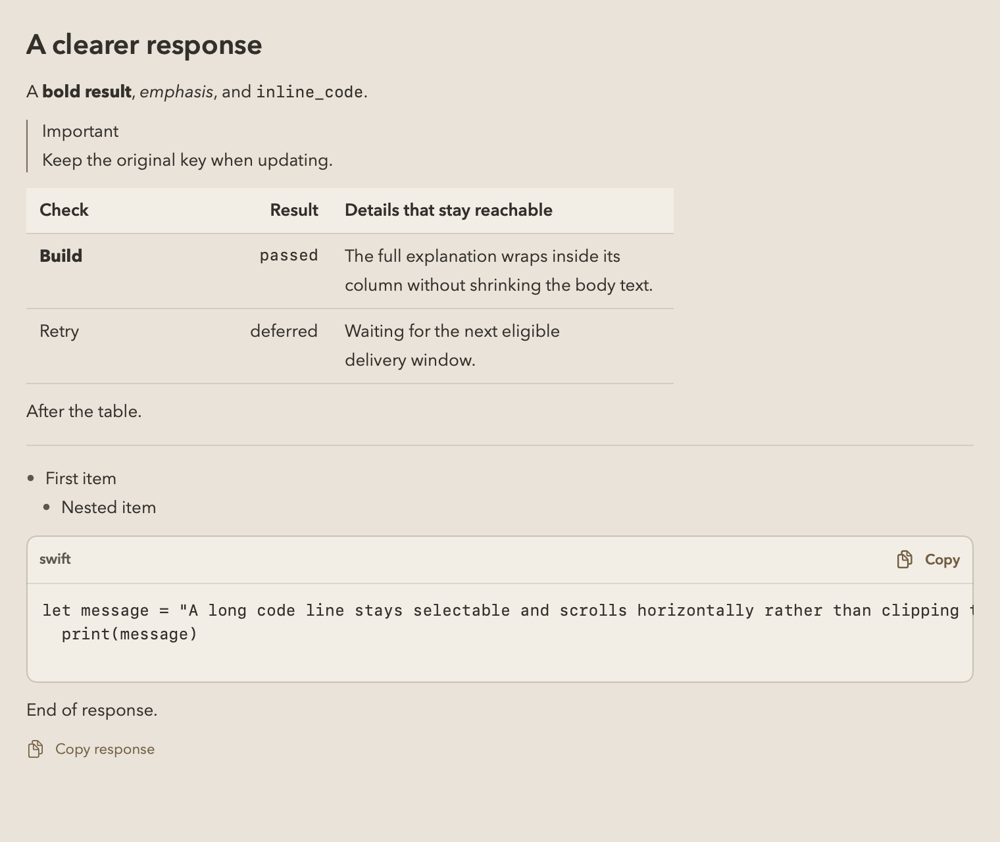
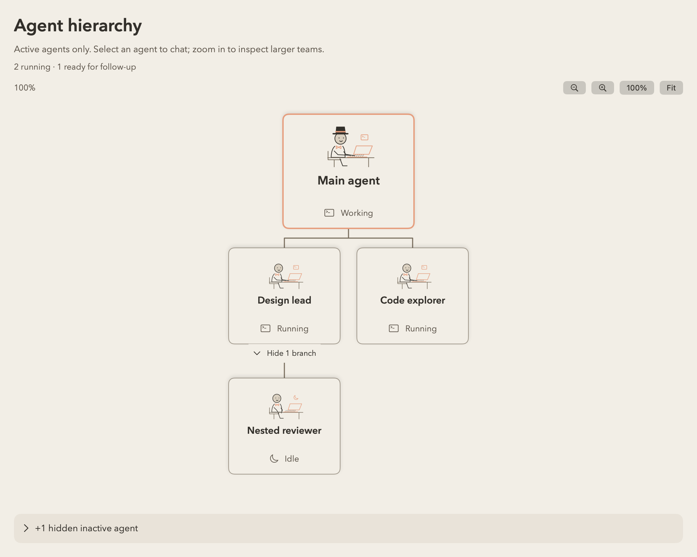
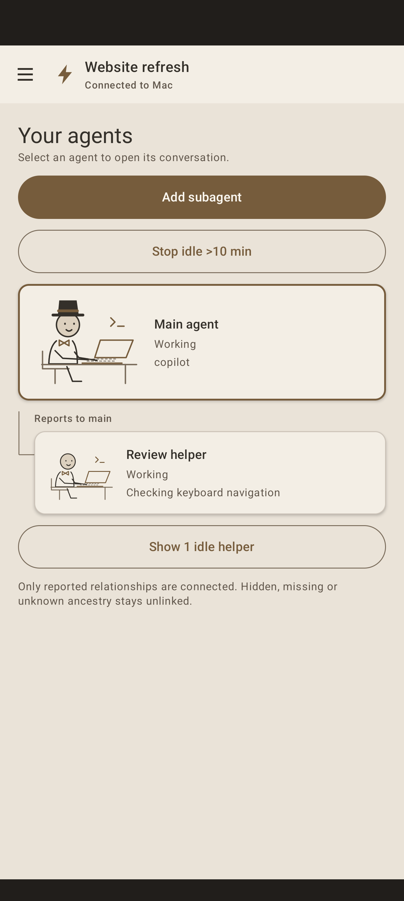

# Notify

**Your terminal needs an answer. Stay where you are.**

A native Mac companion for Copilot and Claude Code. Review requests, answer questions, follow conversations and see which agent needs you—without replacing your original terminal.

[Install](#install-on-macos) · [Quickstart](#quickstart) · [User guide](docs/guide.md) · [Phone and hosting setup](docs/remote-setup.md)

<picture>
  <source media="(prefers-color-scheme: dark)" srcset="docs/images/visual-teams-dark.png">
  
</picture>

## Choose how to connect

| Mode | What you need |
| --- | --- |
| **Mac only** | Notify, Node.js, and your installed, signed-in agent CLI. **No Notify cloud account, Firebase project or Render service.** Your agent still uses its usual model provider. |
| **Phone on the same Wi-Fi** | The optional LAN web app, an awake Mac and manually verified local certificate trust. No hosted Notify backend. |
| **Phone over the internet** | An explicitly enabled Mac connection, a compatible HTTPS Notify service, a passkey and local approval of the phone's full public key. An operator provisions Render/Firebase; users of an existing service do not each create a project. |

Internet access is separate from LAN pairing and **off whenever Notify starts**. Keep the Mac awake, online and running Notify. Sending instructions can spend your agent's model credits.

## Install on macOS

Get the Apple Silicon ZIP and `SHA256SUMS.txt` from [Mac releases](https://github.com/vsvinav/notify/releases). **Requirements: Apple Silicon, macOS 14+, Node.js 22.18+, and an installed, signed-in Copilot or Claude Code CLI.** Node and the agent CLIs are not bundled. Source builds additionally require Apple's command-line tools and Rust 1.91+.

1. With the ZIP and checksum file together, run `shasum -a 256 -c SHA256SUMS.txt`.
2. Unzip and move **Notify.app** into **Applications in your home folder**. When updating, quit Notify first; leave agent terminals running.
3. Open Notify and choose **Connect agents**.

This beta is **ad-hoc signed, not Developer ID signed or notarized**. If Apple's warning offers **Move to Trash** or **Done**, choose **Done**, then **System Settings > Privacy & Security > Open Anyway**, only if you trust the download. Never disable Gatekeeper globally. Checksums check bytes, not Apple's approval. [Complete installation and warning guidance](docs/guide.md#install-the-download).

Already installed? Run `open ~/Applications/Notify.app`. Downloads contain no personal accounts, settings, paired phones or session history. Connect agents and pair each Mac separately.

**Release scope:** **[beta 5 / build 11](https://github.com/vsvinav/notify/releases/tag/v0.2.0-beta.5)** includes pairing/reconnect recovery, Android session-management support, the matching amber lightning icon and background-approval alert fixes. Use Android 0.3.1 or later for the corresponding receiver and draft fixes. A changed ad-hoc signer can require explicit phone re-pairing when replacing an older download; never reset pairing automatically. Check the selected release's notes rather than assuming an older download includes newer source features.

**Release policy for Notify repositories:** publish client updates as versioned
GitHub releases with installable artifacts and SHA-256 checksums: the Mac app ZIP
in this repository and the Android APK in its private repository. A source-only
merge is not a release. Label previews and disclose remaining acceptance limits;
never publish personal settings, identities or private local-build paths.

## Quickstart

1. **Connect agents.** Review the setup and access notice in Notify. Accounts and login remain with your CLI.
2. **Connect the original session.** Copilot uses an explicitly enabled extension; Claude uses explicitly installed hooks. Notify does not restart terminals, reload extensions automatically or enable global permissions.
3. **Review and reply.** The floating panel shows the actual command, address or question. Approve, deny or answer only what you intend.
4. **Follow the session.** Open **Chat** for reported messages and **Tools & thinking** for supplied activity. Select a helper in **Your team** to inspect that exact subagent.

**Existing Copilot:** if experimental mode is already enabled, use `/extensions manage`, enable Notify, close the manager with **Esc**, then review its permission-access request. Reload the extension explicitly after an update when needed. Do not switch experimental mode on during active work: it can restart the CLI UI. [Connection steps](docs/guide.md#existing-copilot-terminals).

**Existing Claude Code:** choose **Connect agents > Claude Code > Add hooks** and review the destination. Wait until the terminal is idle before reviewing and closing `/hooks`; in Claude 2.1.81 this ends the current turn. Connection starts on the next hook event, not by resuming another copy. Existing blocked prompts stay in the terminal. [Setup and capability limits](docs/guide.md#existing-claude-code-terminals).

Try a fictional request without an agent call or model credits:

```sh
~/Applications/Notify.app/Contents/Resources/bin/notify demo
```

## What you can do

- **Answer precisely:** supported approvals, denials, choices and custom answers; the original terminal remains usable.
- **Read and organize:** Markdown replies, copyable code, session colors, saved chats, light/dark appearance and exact iTerm2 navigation.

- **See the team:** a main agent, running helpers and an expandable idle group; missing relationships are labeled, not invented.
- **Steer supported Copilot sessions:** main/subagent messages, Interrupt, confirmed Stop and supported subagent creation/removal. Ended or unsupported targets remain read-only.
- **Clean up carefully:** **Stop idle >10 min** requires confirmation and skips unknown idle ages or unsafe ancestry. It does not stop main agents or delete project files.
- **Catch up optionally:** explicit Haiku summaries send a limited conversation excerpt through your agent account and use model allowance.
- **Use your phone:** live requests, recent conversations and supported controls, subject to the same agent capabilities and exact acknowledgments.

**Claude hooks are not full control parity.** Original Claude terminals cannot receive Notify's Send/Interrupt/Stop or direct subagent creation/removal commands. Questions appear only when the runtime supplies a supported hook.

**Keyboard priority:** while a floating request is visible, Up/Down and Return go to Notify—even from another app. Return can activate an approval or Deny. Hide or snooze the panel to return those keys.

**Dangerous Auto-yes is optional and dangerous.** It may approve destructive commands and external actions. It is session-specific, requires explicit confirmation, resets on provider disconnect/restart (not phone disconnect), and never bypasses runtime restrictions. [Limits and Off controls](docs/guide.md#dangerous-auto-yes).

## Use your phone

**Session parity:** matching Mac 0.2.0 build 10 source/helper and Android 0.3.0
beta builds add **Session settings** on the phone: the Mac's named color
choices/custom RGB display and real **Reset automatic**, shared same-group
**Move up/down**, confirmed **Remove from Notify**, and supported saved
Copilot/Claude **Resume on Mac**. Colors and order follow the original session
identity across reconnects; failures are shown rather than saved optimistically.
These are not claims about older downloads or installed builds.

Removal deletes only a disconnected cached row from Notify—not CLI history or
project files—and never stops an owner or unpairs a phone. Discovery may restore
the row. Resume uses only native registry/history and the original installed CLI
with iTerm2; live owners and pending launches block duplicates. Confirmation
explains possible Mac sign-in/Automation prompts and saved CLI permissions
(including prior allow-all). It sends no approvals or connection consent and
does not enable session Auto-yes. **Launch is not connection:** the Mac reports
launching/awaiting connection separately from a detected owner or matching
connected session, with a 30-second no-owner warning. Failure or uncertainty is
never retried automatically. A new explicit resume review can become available
after the Mac observes the original owner and its return to Saved, even if it
never connected to Notify. That authorization survives later phones' completed
launches and missed updates, but not replacement of its Mac/session/project
scope. Stale reviews rejected before dispatch show a failed
receipt; refresh and review a new action rather than replaying the old command.
Android's **System / Light / Dark** appearance
choice affects that phone only. Headless checks and fictional Android layout
checks cover these controls; real-terminal acceptance remains separate.

**Same Wi-Fi:** enable **Settings > Phone connections > Allow phone connections**, choose **Pair a phone**, and follow the [iPhone/Android web-app setup](https://github.com/vsvinav/notify-mobile/tree/feature/remote-access#quickstart). Verify the local certificate independently before trusting it; compare pairing codes locally. No App Store install is required. Internet mode does not require this local CA.

**Internet:** use **Settings > Internet**, enter your operator's exact HTTPS origin and enable access. The updated helper prepares a fresh pairing QR automatically; use **Pair an internet device** to retry or replace an expired invitation. Sign in with a passkey, then compare the **complete public key** on both devices before approving on the Mac. A short code is insufficient. The Android native client is separate from the LAN web app; use its versioned APK and release instructions supplied by your operator.

**Native Android, current development build:** choose **Scan Mac QR**, grant camera
permission when asked, and scan the Mac's invitation instead of entering technical
fields. Passkey verification and explicit full-key approval on the Mac still apply.
The phone has a searchable session drawer and **Chat / Decision / Agents** views,
with the Mac's illustrated characters and warm light/dark palette. The matching
lightning icons use amber on warm charcoal. Android 0.3.0 is a prerelease;
these changes are not in the older 0.2.0 APK. Matching updated Mac/helper
builds also support live-catalog helper creation, ended-helper removal, and
confirmed idle cleanup. Matching Mac/helper builds and Android 0.3.0 support
Dangerous Auto-yes control of the same Mac-owned session policy: high-risk enable
confirmation, red acknowledged On state, and direct Off. Phone disconnect leaves
it enabled; stale state never claims Off, and toggles are never replayed. Older
builds show unsupported. Native fictional layout checks passed; real policy
activation, camera and physical keyboard interaction remain separate acceptance checks.
Android 0.3.1 additionally keeps drafts editable during connection changes or
uncertain delivery without relaxing Send or approval guards.

**Different account or stuck pairing:** try the original Notify passkey first. Build 7 adds **Start fresh internet setup** under **Pairing recovery**: turn internet off, wait for the helper to stop, and confirm the private backup before pairing again. It never resets automatically or changes terminal sessions, LAN pairing or Google passkeys. This recovery button requires beta 5/build 11 or a corresponding development build. See [safe recovery](docs/remote-setup.md#8-revoke-rotate-and-recover-safely).

[Complete setup: joining a service, Render, Firebase/Firestore, Android and alerts](docs/remote-setup.md).

Durable Firestore preserves approved pairing across normal service restarts; account sessions and routing grants are short-lived, so sign-in can be required again. Records already lost by an older memory-only service cannot be reconstructed: one explicit new enrollment may be necessary. Never delete or silently import trust to repair it.

Internet browser access needs an open page; internet browser push is not connected. Android alerts are opt-in, generic FCM nudges—not command transport. Mac build 11 can signal waiting work even when the phone's encrypted conversation is closed; deferred nudges are coalesced and retried for at most two minutes while work remains waiting. Opening an alert fetches fresh encrypted state from the Mac. Installed Mac build 11 and Android 0.3.1 passed one real-internet locked-phone delivery check with user-confirmed vibration. Sound and other device/network configurations remain unverified; provider acceptance alone is not delivery proof. Free Render can sleep or hit quotas, and no phone can control a sleeping/offline Mac.

## Screenshots

**Upcoming Markdown update (build 12, not in beta 5):** response tables, quoted
advice and dividers get native formatting alongside existing headings, lists
and fenced code. Wide tables and long code scroll sideways without shrinking
text. Unsupported tables wider than 16 columns stay as selectable source;
**Copy response** always retains the original response.

<picture>
  <source media="(prefers-color-scheme: dark)" srcset="docs/images/chat-markdown-dark.png">
  
</picture>

This is an offscreen capture of the actual native response component with
fictional text, not a live conversation or a screenshot of the whole app.

<p align="center">
  
  
</p>

<picture>
  <source media="(prefers-color-scheme: dark)" srcset="docs/images/visual-hierarchy-dark.png">
  
</picture>

*Existing native Mac app captures with fictional sessions, not private account
screens. They are retained for the current workspace layout; the icon above is
generated from the updated Mac icon source.*

<picture>
  <source media="(prefers-color-scheme: dark)" srcset="docs/images/android-agents-native-dark.png">
  
</picture>

*Native Android capture from the shipping Compose components in an isolated
fictional test app. Eleven on-device layout checks passed, including light/dark
and narrow/enlarged-text cases. The connected label is synthetic; this image
does not establish real pairing, agent execution or notification delivery.*

## Build from source

Use the matching branches and keep both checkouts updated together:

```sh
git clone --branch main https://github.com/vsvinav/notify.git
git clone --branch main https://github.com/vsvinav/notify-mobile.git
cd notify
(cd bridge && NODE_TLS_REJECT_UNAUTHORIZED=1 npm ci --ignore-scripts)
NODE_TLS_REJECT_UNAUTHORIZED=1 NOTIFY_MOBILE_SOURCE=../notify-mobile bash scripts/build.sh
bash scripts/install.sh
open ~/Applications/Notify.app
```

The installer refuses to replace an existing app or launcher. Follow [updating Notify](docs/guide.md#updating-notify) instead. Source rebuilds can change ad-hoc signing identity and make existing hardware-backed keys inaccessible; never reset identity or replace a nested signer merely to suppress that error.

[User guide](docs/guide.md) · [Current limits](docs/guide.md#local-data-and-limits) · [Report an issue](https://github.com/vsvinav/notify/issues) · [Previous app (v1)](https://github.com/vsvinav/notify/tree/v1)
