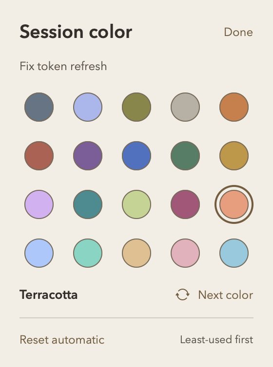

# Notify

**Your terminal needs an answer. Stay where you are.**

A lightweight native Mac app for Copilot and Claude Code. See which session needs you, review its request, and approve, deny or answer from a floating panel. Connect your phone when you want to step away from the Mac.

**Chat with your team:** message connected Copilot sessions and supported subagents, follow readable responses, and spot the larger hat-wearing main agent at a glance. The [previous app and its installation guide are preserved on v1](https://github.com/vsvinav/notify/tree/v1).

[Install on Mac](#install-on-macos) · [Quickstart](#quickstart) · [Screenshots](#screenshots) · [Install on your phone](#use-your-phone)

<picture>
  <source media="(prefers-color-scheme: dark)" srcset="docs/images/visual-teams-dark.png">
  
</picture>

## Install on macOS

**Already installed?** Open Notify from your home folder's **Applications** folder, or run:

```sh
open ~/Applications/Notify.app
```

**First installation:** the current version is built locally. There is no downloadable notarized installer yet.

You'll need **macOS 14+**, **Node.js 22.18+**, Apple's command-line tools, and an installed, signed-in Copilot or Claude Code CLI. If Apple's tools are missing, run `xcode-select --install` first. Both repositories must be accessible to your GitHub account; the mobile companion repository is currently private.

```sh
git clone https://github.com/vsvinav/notify.git
git clone https://github.com/vsvinav/notify-mobile.git
cd notify

(cd bridge && NODE_TLS_REJECT_UNAUTHORIZED=1 npm ci --ignore-scripts)
NOTIFY_MOBILE_SOURCE=../notify-mobile bash scripts/build.sh
bash scripts/install.sh

open ~/Applications/Notify.app
```

This installs **`~/Applications/Notify.app`** and the **`~/.local/bin/notify`** launcher. It does not change your agent's login or global permission settings. The installer refuses to overwrite an existing app or launcher; use the [update instructions](docs/guide.md#updating-notify) for an existing installation.

## Quickstart

1. **Open Notify and choose Connect agents.** The setup screen finds your installed CLIs and explains how to connect them.
2. **Connect a session.** Copilot can keep its original terminal through Notify's extension. Claude currently uses a new SDK-backed chat started with Notify's launcher. Follow the agent-specific instructions in the app.
3. **Answer a request.** A floating panel shows the session, project and exact command, address or question. Approve, deny, choose an option, or write your own answer where supported.
4. **Make it yours.** Pick System, Light or Dark in main Settings. Assign session colors, reorder sessions, or connect your phone.

Select a connected Copilot session's **Chat** tab, type a message and choose **Send**. Click a helper in **Your team** to open its own chat and **Stop subagent** control. Sending to an idle supported helper wakes it for follow-up; ended helpers stay read-only. The main agent has separate **Interrupt** and **Stop main** controls, with confirmation.

**Already connected but controls are unavailable?** Reload the Notify extension in that Copilot terminal. Existing Claude terminals and unsupported helpers cannot be messaged through Notify; the app explains when a control is unavailable.

Try a sample request without starting an agent or spending model credits:

```sh
~/.local/bin/notify demo
```

**Existing Copilot sessions:** if experimental mode is already enabled, enable Notify through `/extensions manage`, press **Esc** to close the manager, then grant the extension permission access. Do not turn experimental mode on during active work: that can restart Copilot's UI. [Full connection steps](docs/guide.md#existing-copilot-terminals).

## Screenshots

### Answer without switching apps

<p align="center">
  <picture>
    <source media="(prefers-color-scheme: dark)" srcset="docs/images/notification-dark.png">
    
  </picture>
  <picture>
    <source media="(prefers-color-scheme: dark)" srcset="docs/images/session-colors-dark.png">
    
  </picture>
</p>

### Keep an eye on unattended work

<picture>
  <source media="(prefers-color-scheme: dark)" srcset="docs/images/visual-controls-dark.png">
  
</picture>

<p align="center"><sub>Captured from the native app with example sessions. These are rendered app screens, not mockups.</sub></p>

## What you can do

- **Review the actual request.** Prominent commands, URLs and paths; expandable details when you need them.
- **Reply your way.** Approvals, denials, single/multiple choices and supported custom answers.
- **Keep sessions organized.** Live and saved sessions, clear connection states, drag-to-reorder and twenty shared colors.
- **See the team.** A larger hat-wearing main agent and smaller helpers type while working and blink or glance while idle. Motion pauses when hidden or Reduce Motion is enabled.
- **Read responses, not tool logs.** Assistant replies render as Markdown with headings, lists and code blocks with Copy.
- **Chat and steer.** Send to the main session or a supported helper. Separate stop controls keep the destination clear. This is native chat, not an embedded terminal.
- **Copy and catch up.** Copy responses, messages, code or the observed chat. Optional Haiku summaries use a limited excerpt and return complete paragraphs up to 250 words.
- **Choose when to step aside.** Supported Copilot sessions offer separate Dangerous Auto-yes for waiting and future eligible tools, with explicit confirmation, red warnings and an Off control.
- **Use your phone.** Pair an iPhone or Android Home Screen app for same-network replies and optional generic background alerts.

**Keyboard priority:** while a request is visible, Up/Down and Return go to Notify, even from another app. Return activates the highlighted choice, including a remembered approval or Deny. Hide or snooze the panel to give those keys back.

**Dangerous means dangerous:** auto-approved tools can delete files or perform external actions. The mode is temporary and session-specific; it does not answer questions or override agent restrictions. [Approval controls and limits](docs/guide.md#dangerous-auto-yes).

## Use your phone

In main **Settings > Phone connections**, enable **Allow phone connections** and choose **Pair a phone**. Scan the QR displayed on your own Mac, verify and trust its local certificate, then install Notify to your phone's Home Screen.

Open that installed app, enter the Mac's pairing code, compare the confirmation codes, and confirm the phone on the Mac. Enable alerts from the phone app.

**[iPhone and Android installation guide →](https://github.com/vsvinav/notify-mobile#quickstart)**

Your Mac must be awake and reachable on the same network for request details and replies. Generic alerts use platform push services. Physical-phone certificate setup and lock-screen delivery still need real-device verification; there is no App Store release or hosted Notify relay.

---

[Install and use guide](docs/guide.md) · [Connection help](docs/guide.md#connect-agents) · [Current limits](docs/guide.md#local-data-and-limits) · [Report an issue](https://github.com/vsvinav/notify/issues)
