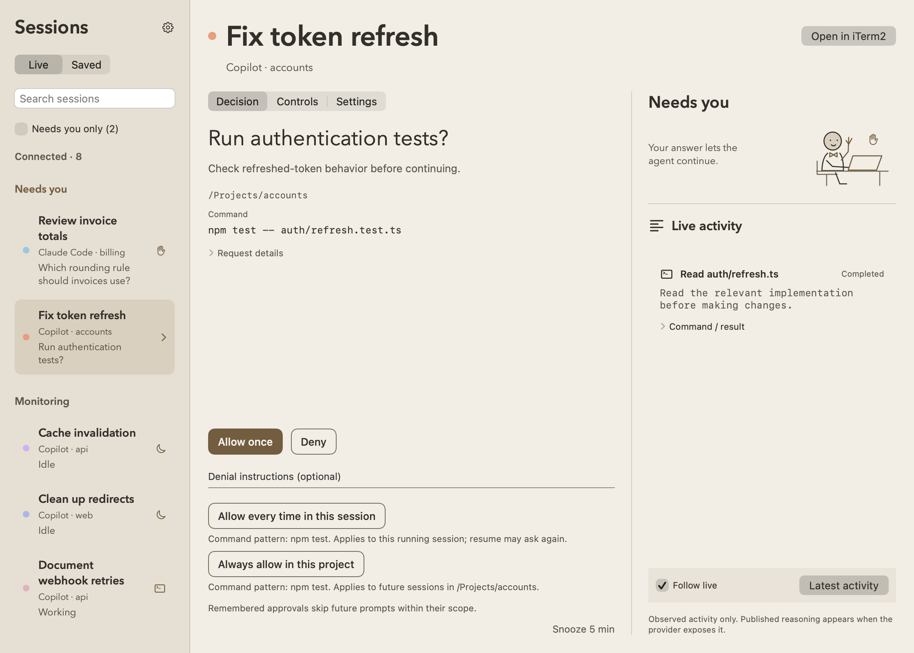
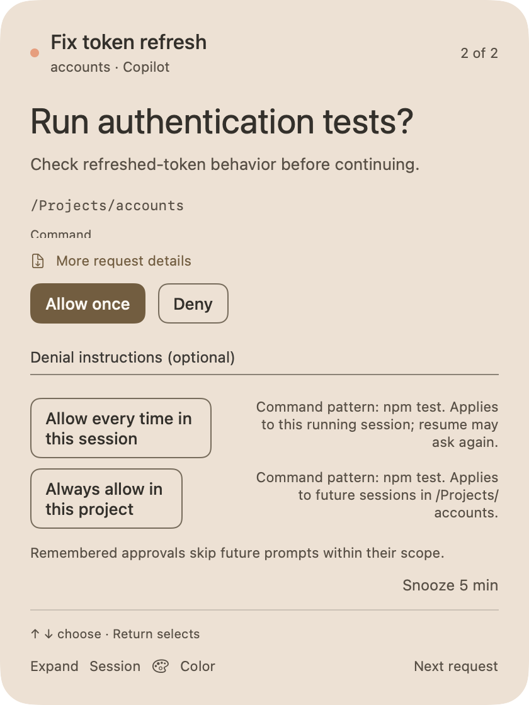

# Notify

**Your agents are working. Stay with what you're doing.**

Answer Copilot and Claude Code requests from a small floating panel, without switching back to the terminal.

<picture>
  <source media="(prefers-color-scheme: dark)" srcset="docs/images/sessions-dark.png">
  
</picture>

## A little less switching

- **Know who needs you.** See the agent, project, and request before you respond.
- **Answer right there.** Approve, deny, pick an option, or write your own answer.
- **Keep your hands on the keyboard.** Up/Down choose; Return activates the highlighted choice.
- **Keep sessions straight.** Drag to reorder, clear connection groups, and shared colors you can change right from a notification.
- **Watch and steer.** Live activity beside your controls, with a little agent that works, waits, and rests.
- **Keep your terminal.** Attach to an existing Copilot session without replacing it.
- **Easy on the eyes.** Muted beige by day, warm charcoal by night. Follows your Mac's appearance.

<p align="center">
  <picture>
    <source media="(prefers-color-scheme: dark)" srcset="docs/images/notification-dark.png">
    
  </picture>
</p>

<p align="center"><sub>Real app captures with fictional sessions.</sub></p>

**Keyboard priority:** while a request is visible, Up/Down and Return go to Notify—even from another app. Return activates the highlighted option, including a remembered approval or Deny. Snooze or hide the notification to give those keys back.

## Try it

Currently a local build, not a notarized download. Requires **macOS 14+**, **Node.js 22.18+**, Swift command-line tools, and an installed, signed-in agent CLI.

```sh
git clone https://github.com/vsvinav/notify.git
cd notify
(cd bridge && npm ci --ignore-scripts)
bash scripts/build.sh
bash scripts/install.sh
open ~/Applications/Notify.app
```

Preview a request without running an agent or spending model credits:

```sh
~/.local/bin/notify demo
```

### Connect your agent

**Already using Copilot?** Install the extension:

```sh
~/.local/bin/notify setup-copilot
```

In Copilot, enable **notify** in `/extensions manage`, close the manager with Esc, and grant permission access. Experimental mode must already be enabled; don't toggle it during active work. [Connection details →](docs/guide.md#existing-copilot-terminals)

**Starting fresh?** Launch from your project folder:

```sh
~/.local/bin/notify claude
# or
~/.local/bin/notify copilot
```

These are SDK-backed terminal chats, not the original full-screen CLIs. Existing Claude terminals cannot attach yet.

---

Native SwiftUI/AppKit. No embedded browser or separate Notify cloud service. Your agents still use their usual model providers.

[Full guide](docs/guide.md) · [Permissions & safety](docs/guide.md#replying) · [Current limitations](docs/guide.md#local-data-and-limits) · [Development checks](docs/guide.md#checks)
