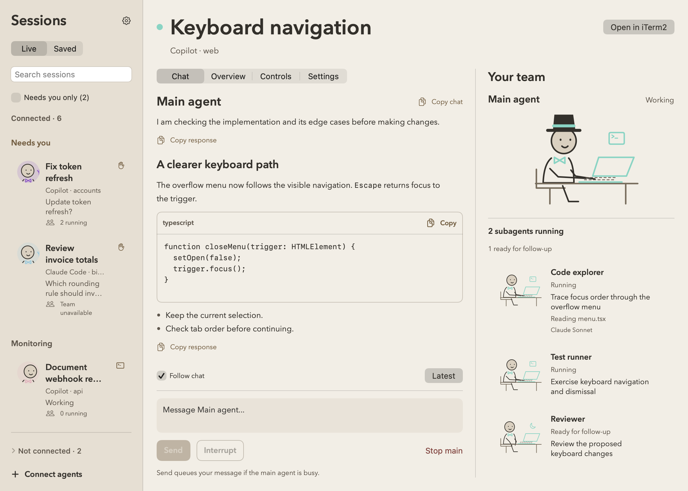
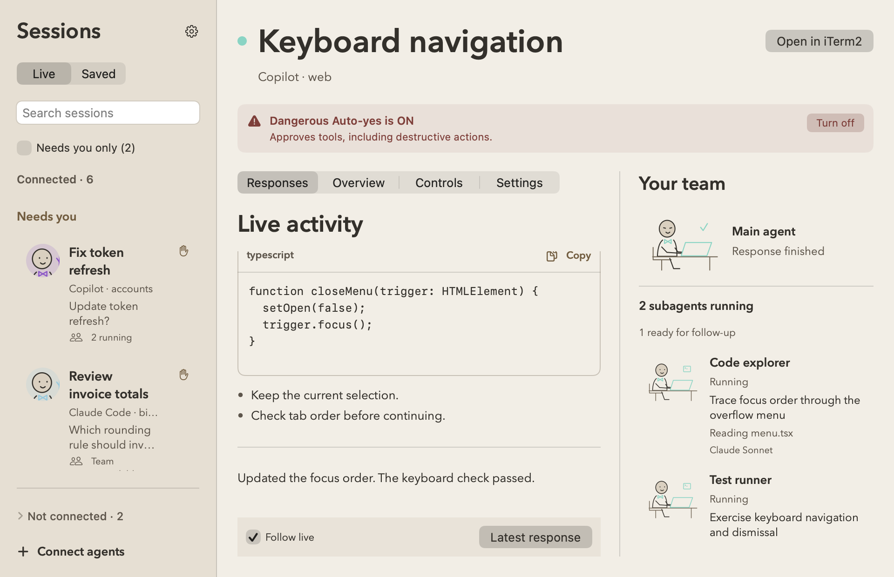

# Notify

**Your terminal needs an answer. Stay where you are.**

A lightweight native Mac app for Copilot and Claude Code. See which session needs you, review its request, and approve, deny or answer from a floating panel. Connect your phone when you want to step away from the Mac.

**Claude integration preview:** the hook integration described below is on `feature/claude-code-parity`, not in the published beta 3 download. Build this branch to use it; unsupported Claude controls remain disabled.

**Chat with your team:** message connected Copilot sessions and supported subagents, follow readable responses, and spot the larger hat-wearing main agent at a glance. The [previous app and its installation guide are preserved on v1](https://github.com/vsvinav/notify/tree/v1).

[Install on Mac](#install-on-macos) · [Quickstart](#quickstart) · [Screenshots](#screenshots) · [Install on your phone](#use-your-phone)

<picture>
  <source media="(prefers-color-scheme: dark)" srcset="docs/images/visual-teams-dark.png">
  
</picture>

## Install on macOS

**Already installed?** Open Notify from your home folder's **Applications** folder, or run:

```sh
open ~/Applications/Notify.app
```

**Download:** get **Notify-0.2.0-beta.3-macos-arm64.zip** from the [macOS beta release](https://github.com/vsvinav/notify/releases/tag/v0.2.0-beta.3). Requires an **Apple Silicon Mac, macOS 14+, Node.js 22.18+**, and an installed, signed-in Copilot or Claude Code CLI. Unzip it and move **Notify.app** into **Applications in your home folder**, then open it and choose **Connect agents**. No source checkout or Apple build tools are needed. **INSTALL.txt** inside the ZIP includes first-launch instructions.

This test build is ad-hoc signed, **not Developer ID signed or notarized**. If Apple's warning offers only **Move to Trash** or **Done**, click **Done**, then find Notify's **Open Anyway** button in **System Settings > Privacy & Security**. See [full Gatekeeper guidance](docs/guide.md#install-the-download). A checksum does not bypass this warning. The download does not include your accounts, settings, paired phones or sessions; connect agents separately on the other Mac.

**Build from source instead:** you'll also need Apple's command-line tools. If missing, run `xcode-select --install` first.

```sh
git clone --branch feature/claude-code-parity https://github.com/vsvinav/notify.git
git clone https://github.com/vsvinav/notify-mobile.git
cd notify

(cd bridge && NODE_TLS_REJECT_UNAUTHORIZED=1 npm ci --ignore-scripts)
NOTIFY_MOBILE_SOURCE=../notify-mobile bash scripts/build.sh
bash scripts/install.sh

open ~/Applications/Notify.app
```

This installs **`~/Applications/Notify.app`** and the **`~/.local/bin/notify`** launcher. It does not change your agent's login or global permission settings. The installer refuses to overwrite an existing app or launcher; use the [update instructions](docs/guide.md#updating-notify) for an existing installation.

## Quickstart

1. **Open Notify and choose Connect agents.** The setup screen finds your installed CLIs and explains how to connect them.
2. **Connect a session.** Copilot keeps its original terminal through Notify's extension. Claude Code uses explicitly installed hooks; new sessions load them automatically, while existing sessions need to accept the changes and emit a new hook event. Follow the agent-specific instructions in the app.
3. **Answer a request.** A floating panel shows the session, project and exact command, address or question. Approve, deny, choose an option, or write your own answer where supported.
4. **Make it yours.** Pick System, Light or Dark in main Settings. Assign session colors, reorder sessions, or connect your phone.

Select a connected Copilot session's **Chat** tab, type a message and choose **Send**. Click a helper in **Your team** to open its own chat and **Stop subagent** control. Sending to an idle supported helper wakes it for follow-up; ended helpers stay read-only. The main agent has separate **Interrupt** and **Stop main** controls, with confirmation.

Helper chats have their own portrait, name and tinted **Subagent chat** header. **Tools & thinking** opens with distinct recent activity entries; expand an entry for its details. All messaging controls live in **Chat**, while Auto-yes remains in **Settings**. There is no separate, duplicate Controls tab.

Agent tiles have subtle raised surfaces and hover/press feedback. **Hierarchy** shows running helpers and one clickable **+N idle subagents** tile. One main agent, one running helper and nineteen idle helpers means **three tiles** by default. Expand the idle tile to restore those helpers and their reported relationships; **Hide idle** collapses them again. **Fit**, zoom and **100%** keep larger charts navigable. Completed, failed and stopped helpers remain in a separate inactive block. Hidden parents are named rather than replaced by made-up connections.

**Add a Copilot subagent:** choose **Add subagent** in the selected session header. Enter its name and instructions, choose a live agent type and model (or **Configured default**), then **Create subagent**. Creation uses your account's model credits and retains runtime permission rules. The same panel has a separate, confirmed **Remove from list** action for ended helpers; it does not stop agents or delete project files. Reload existing Copilot extensions to enable these controls. **Claude Code subagent creation, model selection and removal through Notify are unsupported**, not silently routed through Copilot.

**Clean up idle helpers:** choose **Stop idle >10 min** in the Control Center sidebar, then confirm. This checks all connected supported Copilot sessions, not just the selected one. Only helpers continuously observed idle for more than ten minutes are eligible; unknown ages or unsafe ancestry are skipped. It does not stop main agents or delete work. Each session shows its own result. [Cleanup limits and setup](docs/guide.md#stopping-idle-subagents).

The updated Copilot extension streams partial assistant replies instead of waiting for completion. Reload it explicitly in each existing terminal to receive this change. Messages still queued in the terminal appear when the runtime consumes them.

**Already connected but controls are unavailable?** Reload the Notify extension in that Copilot terminal. Existing Claude terminals and unsupported helpers cannot be messaged through Notify; the app explains when a control is unavailable.

Try a sample request without starting an agent or spending model credits:

```sh
~/.local/bin/notify demo
```

**Existing Copilot sessions:** if experimental mode is already enabled, enable Notify through `/extensions manage`, press **Esc** to close the manager, then grant the extension permission access. Do not turn experimental mode on during active work: that can restart Copilot's UI. [Full connection steps](docs/guide.md#existing-copilot-terminals).

**Existing Claude Code sessions:** choose **Connect agents > Claude Code > Add hooks** and review the destination and access notice. Wait until Claude is idle, then review and close `/hooks` in its original terminal. **Opening `/hooks` ends the current turn in Claude 2.1.81; do not do it during active work.** Connection starts on the next hook event, without resuming a second copy of the session. Prompts already waiting before attachment stay in the terminal. [Claude setup and limits](docs/guide.md#existing-claude-code-terminals).

Claude sessions share the native session list, floating decisions, reported responses, observed team chart, session colors, exact iTerm2 navigation and optional summaries. This is **not complete control parity**: original Claude terminals cannot receive Notify's Send/Interrupt/Stop or direct subagent creation/removal commands.

## Screenshots

### Answer without switching apps

<p align="center">
  <picture>
    <source media="(prefers-color-scheme: dark)" srcset="docs/images/notification-dark.png">
    
  </picture>
  <picture>
    <source media="(prefers-color-scheme: dark)" srcset="docs/images/session-colors-dark.png">
    
  </picture>
</p>

### Keep an eye on unattended work

<picture>
  <source media="(prefers-color-scheme: dark)" srcset="docs/images/visual-controls-dark.png">
  
</picture>

### Follow each agent's team

<picture>
  <source media="(prefers-color-scheme: dark)" srcset="docs/images/visual-hierarchy-dark.png">
  
</picture>

<p align="center"><sub>Captured from the native app with example sessions. These are rendered app screens, not mockups.</sub></p>

## What you can do

- **Review the actual request.** Prominent commands, URLs and paths; expandable details when you need them.
- **Reply your way.** Approvals, denials, single/multiple choices and supported custom answers.
- **Keep sessions organized.** Live and saved sessions, clear connection states, drag-to-reorder and twenty shared colors.
- **See the team.** A larger hat-wearing main agent and smaller helpers type while working and blink or glance while idle. Motion pauses when hidden or Reduce Motion is enabled.
- **Follow the hierarchy.** Explore parent-child branches and live statuses in the Mac Hierarchy tab. Older sessions may lack reported parent information.
- **Read responses, not tool logs.** Assistant replies render as Markdown with headings, lists and code blocks with Copy.
- **Chat and steer.** Send to the main session or a supported helper. Separate stop controls keep the destination clear. This is native chat, not an embedded terminal.
- **Copy and catch up.** Copy responses, messages, code or the observed chat. Optional Haiku summaries use a limited excerpt and return complete paragraphs up to 250 words.
- **Choose when to step aside.** Supported Copilot sessions offer separate Dangerous Auto-yes for waiting and future eligible tools, with explicit confirmation, red warnings and an Off control.
- **Use your phone.** Pair an iPhone or Android Home Screen app for approvals, live session chat, exact-agent controls, a grouped org chart and optional generic background alerts.

**Keyboard priority:** while a request is visible, Up/Down and Return go to Notify, even from another app. Return activates the highlighted choice, including a remembered approval or Deny. Hide or snooze the panel to give those keys back.

**Dangerous means dangerous:** auto-approved tools can delete files or perform external actions. The mode is temporary and session-specific; it does not answer questions or override agent restrictions. [Approval controls and limits](docs/guide.md#dangerous-auto-yes).

## Use your phone

Alongside **Requests**, the phone's **Sessions** view now offers live main-agent/subagent chat, separate tool and thinking updates, and an org chart with expandable idle helpers. Send, Interrupt and Stop respect the connected agent's capabilities and preserve your Mac drafts. Update the Mac app, then reopen the installed phone web app on the same network. [Phone workspace guide](https://github.com/vsvinav/notify-mobile#sessions-chat-and-hierarchy).

**Android: there is no APK or Play Store download.** Install Notify as a web app from Chrome:

1. On the Mac, open **Settings > Phone connections**, enable **Allow phone connections**, and click **Pair a phone**.
2. Put the phone on the same Wi-Fi. In **Android Settings > Apps > Chrome > Permissions**, allow **Nearby devices** or **Local network**, if listed, so Chrome can reach the Mac. Scan the Mac's QR or open its exact **`http://…:8080/` setup address** in Chrome.
3. Download `Notify-Local-CA.cer`. Verify its full SHA-256 fingerprint against the Mac using a trusted certificate viewer **before trusting it**. Then install it through Android Settings' **Install a CA certificate** action. [Detailed Android steps](https://github.com/vsvinav/notify-mobile#install-on-android).
4. Open the Mac's **Connection address**, which uses **`https://…:8443/`**. It must load without certificate warnings. In Chrome's **⋮** menu choose **Install app**, or **Add to Home screen > Install**.
5. Open the new Notify icon, enter the Mac's eight-digit pairing code, compare the six-digit confirmation on both devices, and click **Confirm phone** on the Mac.
6. Tap **Enable alerts** on the phone and allow notifications. Use **Send test alert** on the Mac.

**“Site can't be reached” or `ERR_TOO_MANY_RETRIES`?** First check Chrome's **Nearby devices / Local network** permission in Android Settings. A denial can block the connection before it reaches Notify. Certificate installation cannot fix network reachability. Also confirm the companion is enabled, use the exact protocol/port shown on the Mac, and check for guest-network isolation or a VPN blocking local connections. [Connection troubleshooting](https://github.com/vsvinav/notify-mobile#if-the-phone-says-site-cant-be-reached).

**[iPhone installation](https://github.com/vsvinav/notify-mobile#install-on-iphone)** · **[Full phone setup guide](https://github.com/vsvinav/notify-mobile#quickstart)**

Your Mac must be awake and reachable on the same network for request details and replies. Generic alerts use platform push services. Physical-phone certificate setup and lock-screen delivery still need real-device verification; there is no App Store release or hosted Notify relay.

---

[Install and use guide](docs/guide.md) · [Connection help](docs/guide.md#connect-agents) · [Current limits](docs/guide.md#local-data-and-limits) · [Report an issue](https://github.com/vsvinav/notify/issues)
