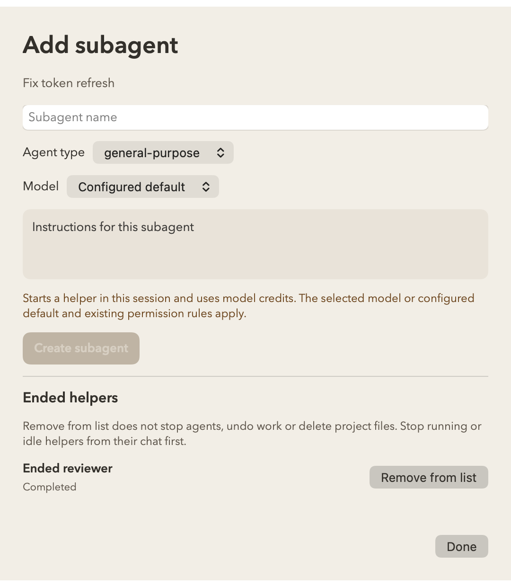

# Install and use Notify

[Back to Notify](../README.md)

A native macOS app for answering Claude Code and Copilot requests without switching back to a terminal.

## Quickstart

1. [Install the download](#install-the-download), [build from source](#build-and-install), or open your existing copy with `open ~/Applications/Notify.app`.
2. Choose **Connect agents** and follow the Copilot or Claude setup shown in the app.
3. Run `~/Applications/Notify.app/Contents/Resources/bin/notify demo` to try the floating controls without starting an agent or spending credits.
4. Answer connected sessions from their floating panels or the control center. Add your phone through **Settings > Phone connections**.

[Current app screenshots](../README.md#screenshots) · [Update an existing installation](#updating-notify) · [LAN phone setup](#phone-connections) · [Internet / Render / Firebase setup](remote-setup.md)

Mac-only use needs no Notify cloud account. LAN phones and internet devices are separate opt-in connections. Internet users can join an existing service; only its operator needs to provision Render/Firebase.

The sidebar puts **Needs you** first, then connected agents you're monitoring. **Not connected** stays separate, and saved chats have their own tab. Select a session, then use **Chat**, **Decision** (or **Overview**), **Settings**, or **Hierarchy**. Click the main agent or a helper in **Your team** to open its conversation. Messaging controls live only in Chat; session automation stays in Settings. A session-colored floating panel brings permission requests, choices, multi-select questions, and text fields to your current desktop.

Notify appears in the Dock and Cmd-Tab. Agent launchers start it in the background without opening the control center or reactivating an already-running app. Closing the control center keeps monitoring active; click the Dock icon to reopen it. Floating requests remain visible when another app is active. Use **Options > Keep in Dock** on its Dock icon to pin it; Notify does not change Dock preferences.

## Session workspace and useful notifications

In Notify's main **Settings**, choose **Appearance: System, Light, or Dark**. System is the default and follows macOS; Light and Dark apply only to Notify, update open windows immediately, and are remembered after restart. Light uses muted beige and taupe; dark uses warm charcoal and sand. Each chat has a stable color shared by its session row and floating notification. Change it using **Session color** in the session's **Settings** tab; **Reset** restores the automatic accent. Notifications use a subtle session tint with contrasting text in both modes. Colors are stored locally and follow the saved chat when it reconnects or resumes. Warning/error colors remain separate.

The illustrated agent reflects observed state: working, thinking when reasoning is reported, needing your answer, or at rest. **Response finished** means a main reply completed and the agent became idle, not that every task or test succeeded. Motion pauses when the control center is hidden and respects macOS Reduce Motion. **Chat** puts Send, Interrupt and Stop below the conversation; unsupported connections explain why these controls are unavailable.

Drag session rows to reorder them within their current group. The order is remembered across app restarts and follows the original chat identity. Move up/down actions are also available to accessibility tools; reordering never changes connection or waiting status.

Floating cards show the chat title and project/agent above the full request. **Session > Open session** selects that exact chat. **Expand** enlarges the panel in place. Sending a reply keeps the card visible until acknowledgment; delivery failures appear inline, not in a blocking control-center popup. Replayed pending prompts do not repeatedly notify, and new arrivals preserve your selected question and draft.

Click the **colored circle beside the session title** on a floating notification to choose from twenty swatches: soft pastels plus richer cobalt, teal, pine, olive, ochre, tangerine, brick, berry, plum and slate. **Next color** cycles to the next least-used color; swatches stay in place while choosing. Usage counts other connected chats once, even if they have multiple records. The same saved color updates the control center immediately. Existing colors are preserved; **Reset automatic** restores the original stable color. Approval shortcuts pause while this picker is open. **More request details** jumps to supplied command/path evidence on shorter panels.

The updated original-Copilot extension supplies the **Live activity** timeline: user/assistant messages, tool commands/results and provider-published reasoning where available. Subagent events are labeled separately. Tool snippets are visible immediately; expand entries for full details. Use **Follow live** or **Latest activity** to catch up. Disconnected sessions show **Recent activity** instead. Older connections retain their existing text preview until you explicitly reload extensions in that terminal.

Activity is a bounded in-memory preview (up to 300 entries and 512 KiB of retained native text per session); individual event previews are limited too. Earlier history remains with the original CLI. Notify does not invent reasoning, test results or progress, nor spend model credits to generate this timeline.

The updated Copilot extension streams partial assistant replies before completion. Existing terminals need an explicit extension reload to load this change. Terminal input still waiting in the agent's queue appears when the runtime consumes it; the app does not yet preview queued input.

## Open and resume in iTerm2

**Saved chats** lists locally saved Copilot and Claude sessions. Select a stopped chat and choose **Resume in iTerm2**. Notify opens the original `copilot --resume <exact-id>` or `claude --resume <exact-id>` in a new iTerm2 window using the saved project folder and configured agent home. It does not send a model prompt.

**Saved Copilot mode and permission settings—including allow-all, if previously enabled—carry over.** The launch confirmation warns about this; Notify's broader per-session Auto-yes stays off. Extension setup and experimental-mode requirements remain explicit.

**Open in iTerm2** checks live ownership and matches the process's terminal to an exact iTerm2 session. A currently running chat is opened instead of resumed again. An absent/ambiguous terminal or denied Automation access produces an error rather than choosing a random tab. Launching is not the same as connecting: permissions remain unavailable until the extension connects.

iTerm2 must be installed at `/Applications/iTerm.app`; Notify finds the agent executable using its setup search paths. macOS may ask permission for Notify to control iTerm2. Missing project folders, linked/ambiguous history locations and existing live owners block a duplicate resume. Claude support is included on this development branch; the beta 3 download predates it.

## Requirements

- macOS 14 or newer; the downloadable beta supports Apple Silicon only. Swift command-line tools are needed only to build from source.
- Node.js 22.18 or newer.
- Claude Code or Copilot CLI installed on `PATH` and already signed in.
- SDK versions are pinned; integration was checked against Claude Code 2.1.81 and Copilot CLI 1.0.112.

## Install the download

1. Download the Apple Silicon ZIP and **SHA256SUMS.txt** from [Mac releases](https://github.com/vsvinav/notify/releases). Read that release's notes for its included features. With both files in the same folder, run `shasum -a 256 -c SHA256SUMS.txt` there to check the download.
2. Unzip the archive. In Finder, open your home folder and create **Applications** there if needed. Move **Notify.app** into that folder. When updating, quit Notify first and replace only the app; leave agent terminals running.
3. Open Notify, choose **Connect agents**, and follow the setup instructions. Install **Node.js 22.18+** and sign in through your Copilot or Claude CLI beforehand. Node and the CLIs are not bundled.

The beta is **ad-hoc signed, not Developer ID signed or notarized**. A successful checksum verifies the downloaded bytes; it does **not** remove Apple's first-launch warning or mean Apple has checked the app.

If the warning says **"Apple could not verify Notify is free of malware"** and offers only **Move to Trash** or **Done**:

1. Click **Done**. The approval button is not in that dialog.
2. Open **System Settings > Privacy & Security** and scroll down to the security section.
3. Find the message about Notify being blocked and click **Open Anyway**.
4. Authenticate if macOS asks, then confirm **Open** in the next prompt, only if you trust this download.

This creates an exception for this app, not a global Gatekeeper disable. See [Apple's illustrated instructions](https://support.apple.com/en-us/102445). If **Open Anyway** is missing or disabled on an organization-managed Mac, do not bypass its policy; ask its administrator. If the warning instead says the app **will damage your computer**, **contains malware**, or **is damaged**, stop rather than applying these instructions.

A notarized release requires Developer ID credentials through Apple's paid Developer Program and is not available yet. Repackaging the app, renaming the ZIP, or checking its checksum cannot substitute for notarization.

The app contains its local phone companion but no account credentials, session history, paired-phone keys or developer settings. Each Mac connects to its own local agent sessions. Reconnect agents and pair phones separately on the new Mac.

The download does not create a command-line shortcut. Use the bundled launcher directly:

```sh
~/Applications/Notify.app/Contents/Resources/bin/notify demo
~/Applications/Notify.app/Contents/Resources/bin/notify setup-copilot
```

Optionally create the shortcut used elsewhere in this guide:

```sh
mkdir -p ~/.local/bin
ln -s "$HOME/Applications/Notify.app/Contents/Resources/bin/notify" ~/.local/bin/notify
```

`ln` refuses to replace an existing shortcut. Keep an existing working launcher when updating.

## Build and install

For a local source build, start from an empty parent folder:

```sh
git clone --branch feature/remote-native-identity https://github.com/vsvinav/notify.git
git clone --branch feature/remote-access https://github.com/vsvinav/notify-mobile.git
cd notify
(cd bridge && NODE_TLS_REJECT_UNAUTHORIZED=1 npm ci --ignore-scripts)
NODE_TLS_REJECT_UNAUTHORIZED=1 NOTIFY_MOBILE_SOURCE=../notify-mobile bash scripts/build.sh
bash scripts/install.sh
open ~/Applications/Notify.app
```

The build requires Rust 1.91+ and an explicit checkout of the separate [notify-mobile repository](https://github.com/vsvinav/notify-mobile), bundles its web app and production dependencies, and ad-hoc signs the combined Mac app. Node itself remains a prerequisite. Phone connections are off by default. If Apple's command-line tools are missing, run `xcode-select --install` and finish their installation first.

The installer creates `~/.local/bin/notify`, without replacing existing apps or launchers. If that directory is not on your PATH:

```sh
export PATH="$HOME/.local/bin:$PATH"
```

Add that line to your shell configuration to retain it in new terminals. Alternatively, invoke `~/.local/bin/notify` directly.

From a project directory:

```sh
notify claude
notify copilot
notify claude --model sonnet "Explain this project"
notify copilot --resume SESSION_ID
notify demo
```

**The launcher uses SDK-backed terminal chat, not the original full-screen CLI interface.** It uses the installed agent executables and their authentication. To keep an original Copilot terminal instead, use the extension below.

`notify demo` exercises permission and multi-field question replies without a model call or executing the example command. The native app opens when the launcher starts. Drag the floating panel to reposition it; use the menu-bar icon to reopen the control center.

### Updating Notify

1. Download and unzip the new release, or get the new source for both repositories and rebuild with `NODE_TLS_REJECT_UNAUTHORIZED=1 NOTIFY_MOBILE_SOURCE=/path/to/notify-mobile bash scripts/build.sh` from the Mac repository.
2. **Quit Notify from its menu**, not just by closing its window. Leave your agent terminals running.
3. In Finder, replace **`~/Applications/Notify.app`** with the downloaded app or new **`build/Notify.app`**. Keep your existing `~/.local/bin/notify` launcher link; do not run the first-install script again.
4. Reopen Notify. Existing extensions reconnect; a changed extension may still require an explicit reload in its original terminal.

Replacing the app does not remove settings or paired-phone data in `~/Library/Application Support/Notify/`. Session Auto-yes modes reset on restart. A repository-access error is not an installation success: obtain access before building.

Internet access also starts off after an app restart. Re-enable it explicitly. Source rebuilds or arbitrary re-signing can make an existing hardware-backed identity inaccessible; preserve the supported nested signer and never silently delete/recreate keys to bypass a signing mismatch. [Internet recovery](remote-setup.md#8-revoke-rotate-and-recover-safely).

## Connect agents

Choose **Connect agents** in the sidebar, main Settings, or menu-bar menu. New users see this welcome flow on their first explicit control-center opening; background launches never open it, and returning users are not forced through it.

Setup finds Copilot, Claude Code and Node in the app's PATH and standard user/Homebrew locations. It checks Node's version without signing in or starting an agent. **Installed CLI found** is not **Connected**: connection status comes from live bridge sessions.

For Copilot, **Install extension** asks before adding the local extension at the displayed path. Existing files are never replaced. Enable Notify and grant permission access in the original terminal yourself, as described below. The app does not toggle experimental mode or restart terminals.

For Claude, **Add hooks** asks before updating the displayed Claude settings file. It uses the same installer as `notify setup-claude`, preserves existing configuration, and does not restart a terminal or relax permission rules. The SDK-backed launcher remains available as a separate option; it is not a way to attach to an original terminal.

**Check again** refreshes prerequisites; it does not change configuration. Accounts, models and API keys remain with the agent. Global approval shortcuts pause while setup is open. **Back to sessions** exits setup without disconnecting anything.

## Existing Copilot terminals

Install the local extension from the installed app:

```sh
~/.local/bin/notify setup-copilot
```

This creates only `~/.copilot/extensions/notify/extension.mjs` (or under `COPILOT_HOME`). It does not change permission settings, restart agents, or overwrite another extension.

In a running Copilot terminal **where experimental mode is already enabled**:

1. Run `/extensions manage` and enable **notify**.
2. **Press Esc to close the manager.** Otherwise its loading screen can hide the permission-access prompt.
3. Approve Notify's request to handle permissions. The session then connects to the existing Notify app.

If the extension is not listed, ask Copilot to reload extensions. The extension joins the same live session; it does not resume a saved copy, replace the terminal, or send a model prompt.

**Copilot 1.0.112 restarts its UI/session initialization when `/settings experimental on` is used. Do not toggle this during active work.** If experimental mode is off, wait for a safe stopping point before enabling it. Future terminals can start with `copilot --experimental`. Notify never toggles this setting itself.

The app discovers live and saved Copilot sessions every 30 seconds using same-user processes, session lock filenames and small local workspace metadata files, without scanning conversation history. Running chats show **Connect extension**, with controls disabled, until connected. Discovery uses the app's `COPILOT_HOME`, or `~/.copilot` by default.

Once connected, permissions, choices, forms, and plan decisions can be answered in Notify or the original terminal. The first accepted response wins. Pending permission prompts are recovered when attaching; a question already blocking initial setup may need one terminal reply first. Closing Notify leaves the original terminal usable, and reopening reconnects outstanding requests.

The Copilot extension does not attach Claude terminals; Claude uses its own hooks below.

## Existing Claude Code terminals

This section describes the current branch; the beta 3 app predates these hooks. Check your selected release's notes before using this setup.

1. Open **Connect agents > Claude Code > Add hooks**. Check the exact settings path and confirm sharing supported requests/activity with Notify and any paired phones.
2. Wait until the already-open Claude terminal is idle, then review and close `/hooks` to accept the changes. **Opening `/hooks` ends the current turn in Claude 2.1.81; do not open it during active work.** Installing hooks alone does not replay a session-start event.
3. Wait for the next hook event from your normal work. **Connected** appears only after the actual hook connection arrives. Do not restart active work or create a duplicate session just to make the row connect.

Alternatively, run `~/.local/bin/notify setup-claude` after installing this build. It respects `CLAUDE_CONFIG_DIR`; use it from that terminal if your shell has a different Claude home than the Mac app. New terminals load accepted hooks automatically.

Notify discovers live Claude owner metadata and indexes saved transcripts in bounded chunks for project/name metadata. It caches only names, project paths and file positions; later refreshes read appended data instead of rescanning unchanged history. The hook connection follows reported conversation entries and subagent lifecycle events; it does not invent missing ancestry or recover a complete earlier conversation.

| Capability | Original Copilot terminal | Original Claude terminal |
| --- | --- | --- |
| Native session list, colors, terminal navigation | Yes | Yes |
| Supported permission requests and supplied remembered scopes | Yes | Via hooks |
| Already-waiting permission recovery on attachment | Yes | No |
| Questions and custom answers | Supported runtime forms | Only if Claude delivers a supported question hook |
| Reported responses and observed team chart | Yes | Yes |
| Native main/subagent messaging and stop controls | Supported connections | Unavailable |
| Direct subagent creation, removal and model selection | Supported connections | Unavailable |
| Explicit Haiku summaries of saved conversation | Yes | Yes |

Questions not delivered through hooks, existing blocked prompts and unsupported controls remain in the original Claude terminal. A hook reply receipt means the response reached the hook's standard output; it does not prove that Claude executed a tool or saved a permission rule. Closing or cancelling a hook retires only its own request. Phone views use the same capability limits.

Claude 2.1.81 was checked with an isolated local provider and its real SDK permission channel: installed hooks delivered allow/deny decisions and question answers to the actual runtime. Plain `claude -p` did not emit a question permission hook. Reloading hooks inside an already-open interactive TUI has not been exercised; the idle-only reload guidance follows that version's command behavior.

## Session descriptions

The session list uses reported Copilot and Claude chat titles rather than a UUID when available, with project and connection status shown separately. Select a session to see its latest activity.

For a richer description, select a Copilot or Claude session and click **Summarize**. After confirmation, Notify sends at most 12,000 characters of saved user/assistant text to Haiku through that agent's account. It excludes tool arguments/results, does not read referenced files, and uses a separate tool-free session. The Claude helper also disables project settings and hooks. This consumes account allowance; nothing runs automatically, and Notify never silently falls back to a different model family. Missing login, model availability and generation failures are shown explicitly.

Descriptions are cached locally with their model and generation time. **Refresh description** is another explicit request. The original chat title and terminal session are never changed. Only one summary runs at a time, with a 60-second generation timeout.

Summaries contain complete paragraphs, up to 250 words and 6,000 characters, rather than being cut off with an ellipsis. Use **Copy summary** to copy the full text. Older cached summaries are not regenerated automatically; choose **Refresh description** to replace one.

## Replying

Use **Allow once**, **Deny**, or the actual question fields. Every response targets one pending request in one connected session. A response is removed only when the bridge acknowledges it; the live Copilot extension waits for runtime acceptance before acknowledging. Questions can be declined; they are never auto-answered.

Every supported remembered scope has its own button with its coverage written underneath. **Clicking an Always/Allow every time button submits immediately: no menu and no second confirmation.** While a connected request is visible in the floating panel, **Up/Down cycle the highlighted choice and Return or keypad Enter activates it**, even from another app. Permissions start on Allow once; deliberately highlighting an Always scope or Deny makes Return activate that choice. The keystroke is consumed, not also delivered to the underlying app. Holding Return cannot approve consecutive requests. No app switch or Accessibility permission is needed.

For questions, Return selects or toggles the highlighted option. A completed single-choice question moves the highlight to Send answer; press Return again to send. For multi-select, toggle the desired choices and navigate to Send answer. Choosing Other focuses its editable input.

**Write your own answer** stays beside the reply controls even when a long option list scrolls. It focuses the existing Other field; for forms with several custom-answer fields, choose the question from its menu. Your draft is preserved until you type, and nothing sends automatically. This follows the agent's advertised choices: custom input appears only where supported, and fixed-choice requests say so.

The global bindings release when the card is hidden, snoozed, disconnected or sending, while editing text in Notify, and during steering. **Keys intended for another app will operate the visible notification instead**; hide or snooze the card to release them.

Built-in Copilot questions offer **Other** with an editable custom answer, including suggested-choice forms. Custom text is preserved for boolean/numeric-style questions too; external MCP forms retain their schema restrictions. Running Copilot extensions must be reloaded to advertise restored custom-answer support.

Copilot supports scoped command/read/write/tool session approvals, project-persisted tool approvals, site approvals, exact-path session approvals and runtime-offered read-only directories. A resumed session may ask again. Supported Copilot requests also have optional instructions sent with **Deny**. Claude launchers expose the complete supported permission-update suggestion supplied by Claude, without inventing rules or changing permission mode. **Remembered approvals can skip future questions; AI can make mistakes.** They are separate from Notify's Auto-yes and are not undone by disabling it. The scope is recorded in approval history before dispatch; SDK-launcher acknowledgments mean the reply was handed back, not proof that the runtime saved a rule.

Full terminal-choice parity is still incomplete: MCP sampling, extension-authority consent, broader managed/sandbox scopes and Claude permission-mode changes are not implemented here. These are explicit integration boundaries, not invented approvals or an “other choices” button. Existing Copilot extensions need an explicit reload to expose new options and denial instructions. Already-running SDK launchers keep their old behavior until restarted.

Long prompts, options and context scroll inside the card while reply buttons remain below. Structured permission context appears as labeled values; question schemas already represented by form controls are not dumped as JSON.

Floating permission cards put the exact URL/URI, command, or file path in larger selectable text before the supplied reason. Addresses retain their scheme, escapes, query and fragment; they are not shortened or opened automatically. Explicit warnings stay above the target. **Request details** expands tool/server identifiers and other known bookkeeping; unknown inputs remain visible because they may affect the decision. Working directories stay visible for commands, paths and non-web resources. **More request details** scrolls to the target when a short panel cannot show everything.

SDK launcher terminals also support this fallback when the app is closed (original Copilot terminals keep their normal controls):

```text
/reply 1234abcd allow
/reply 1234abcd deny
/reply 1234abcd {"0":["SQLite"],"1":["Unit","Integration"]}
/quit
```

Use the request ID and field IDs printed by the launcher. `/quit` cancels pending decisions and ends the launcher. The agent's saved session ID is printed for resuming. The launcher retries its app connection when the app is restarted.

## Safe auto-yes

Enabled by default, with a global switch in Settings and a per-session switch in the Session tab. It only applies to structured file-read requests inside the canonical project directory, using a small source/document extension allowlist. Hidden paths, sensitive filenames, symlink escapes, directory reads, commands, writes, installs, browser actions, and preference questions are not eligible. Copilot managed approvals and sandbox bypasses stay manual.

The SDK's existing permission rules can resolve operations before Notify sees them. This setting does not override those rules or impose a new sandbox. It is not a blanket approval mode. An automatic decision is recorded before dispatch; if the history cannot be written, Notify does not approve it.

## Steer an attached Copilot session

In the control center, choose **Chat** to message the main agent. With beta 6/build 13 and its updated Copilot extension, **Send** steers before the next model request without stopping current work, like Enter in Copilot. **Queue** explicitly waits for the next turn. Older extensions offer **Queue** and reload guidance instead of promising immediate Send. **Interrupt** confirms before interrupting the main turn and sending your draft; **Stop main** confirms before stopping current work and clearing queued main prompts.

Click a subagent in **Your team** to select that helper. Its composer has its own draft and delivery receipts. **Send** steers a running helper or wakes an idle supported helper; **Stop subagent** confirms before cancelling its work. The runtime may also stop its descendants; the main agent and unrelated helpers are not stopped. Existing edits are not undone. Ended, unavailable and unsupported helpers remain read-only. Some runtime task types reject messaging even while listed; that failure is shown rather than redirecting your message. Supported updated Copilot sessions can create helpers using Notify’s live-catalog creation form described below. Restarting an ended helper still requires the original terminal.

The larger main agent wears a hat. Helper chats use a mini portrait, the helper's name and a tinted **Subagent chat** header, with the selected helper highlighted in the team. **Stop main** and **Stop subagent** are filled red buttons and still require confirmation.

### Stopping idle subagents

Choose **Stop idle >10 min** in the Control Center sidebar. Review the notice, then choose **Stop idle subagents**. This is a manual cleanup across **all connected supported sessions**, not just the selected chat. It never runs on a schedule.

The matching **native Android source preview** also offers **Add subagent**,
ended-only **Remove from list**, and **Stop idle >10 min** in **Agents**. Unlike
the Mac sidebar loop, phone cleanup targets **only the selected session** after
confirmation. Creation offers live type/model IDs or **Configured default**,
warns about credits and permission rules, and never sends a main-chat prompt
instead. Native validation, audit and actual runtime acknowledgments remain
authoritative. Catalog changes invalidate reviewed management actions without
resetting chat drafts; rejected/unknown creation preserves form values. Unknown
delivery is not automatically retried. Old Mac/helper builds and Claude do not
advertise dispatchable management. This is unreleased source functionality,
not a change to the installed Android app or the LAN web app.

Copilot must load the updated Notify extension. Idle observation starts when the extension connects; an old creation date does not prove that a helper has been idle. New activity resets that observation. Helpers must have been continuously observed idle for **more than ten minutes**. Missing timing or unsafe/unknown ancestry is skipped. Claude hooks cannot stop subagents, so Claude sessions are explicitly skipped.

Before stopping each helper, Notify rechecks the runtime and protects main agents and descendants that are active or not eligible. The runtime does not offer an atomic “cancel only if still idle” operation, so activity can still change after that final check. Existing edits and project files are not deleted.

Results appear separately for each session, including skipped, failed and uncertain outcomes. A large cleanup may exceed the acknowledgment timeout: **Unknown** does not mean nothing happened. Check the original session rather than immediately retrying; a late acknowledgment can still update the result. Busy sessions are skipped rather than interrupting an existing control.

Long chat replies render their blocks as you scroll instead of laying out the entire reply at once. This reduces work on the UI thread shared with notifications; it does not require killing idle helpers.

Working agents visibly type; idle agents occasionally blink or glance. An acknowledged stop has a still pose. Motion pauses when the window is hidden or Reduce Motion is enabled. An idle or finished response does not mean the whole task succeeded.

Chat shows responses observed while Notify is connected and your messages sent from the app. It is not a complete historical transcript; internal helper prompts are omitted. **Tools & thinking** above the conversation opens with separate tool, thinking and status entries. Scroll through up to 12 recent updates; expand an individual entry for its available details and **Copy activity**. You can collapse the panel to give the conversation more room. No hidden reasoning is inferred.

**Hierarchy** shows observed parent-child relationships as a top-down org chart: parents above their children, siblings side by side. Running helpers appear individually; idle helpers start grouped in one clickable **+N idle subagents** tile. With one main agent, one running helper and nineteen idle helpers, only three tiles appear. Click the idle tile to reveal those helpers with their actual relationships; **Hide idle** groups them again. A helper that resumes running automatically leaves the idle group. **Fit** scales the chart into the viewport; use zoom or **100%** and scroll to inspect expanded teams at readable size.

Completed, failed and stopped helpers stay in a separate **+N hidden inactive agents** block, with failures called out separately. Active children of hidden parents remain visible separately with the actual parent's name, not a false main-agent connection. The idle group is a status summary, not an invented parent.

Select a raised agent tile to open its exact chat, or fold an individual branch. Stopped helpers stay flat with X eyes and cannot be selected; an updated Notify extension retains them for five minutes. Reload existing extensions to receive new lifecycle data. Spawn events that were not observed, missing parents and inconsistent relationships are shown separately without invented connections.

**Copy response**, **Copy message**, **Copy chat** and code-block **Copy** copy their full available text. Scrolling up pauses **Follow chat**; **Latest** returns to the newest message.

The beta 6/build 13 chat update also formats pipe tables, quoted advice,
and horizontal dividers. Scroll a wide table or long code line sideways; text
stays at its normal size. Tables wider than 16 columns, malformed table headers
and unsupported extra cells remain readable source instead of disappearing.
Code-block Copy retains the exact received code, including its whitespace.
This update is not included in beta 5/build 11.

Choose **Steer an Agent** from Notify's menu-bar menu, or **Send instruction** from session details. The floating panel stays available even when no permission is pending. Select the target chat, read its latest activity, and type a direction:

- **Send** steers before the next model request without interrupting or clearing queued input; it requires the updated extension.
- **Queue** submits the direction for the next turn.
- **Interrupt** asks for confirmation, interrupts the main turn while preserving queued prompts/background work, then submits the new direction.
- **Stop** asks for confirmation and aborts current work, clearing queued prompts (including prompts queued in the terminal). It does not undo changes or close the terminal; external processes may continue.

**Submitted** means Send was accepted; **Queued** means explicit Queue was accepted. Neither means the model consumed it: **Received** requires a matching runtime message event. Agent activity is shown separately rather than pretending an unrelated response answers your message. Drafts stay with their session. An unknown delivery is never retried automatically: check the terminal before resending.

These controls require the updated Notify extension in an original Copilot terminal. Existing loaded extensions must be reloaded in that terminal to acquire the new capabilities; ask Copilot to reload its extensions. Notify does not restart the terminal to do this. SDK launchers and Claude remote steering are not supported, and unavailable controls are disabled.

### Create and remove Copilot helpers

Choose **Add subagent** in the connected Copilot session's header. Enter a name and instructions, choose an agent type and model, then click **Create subagent**. Agent types and selectable models come from that runtime's live catalogs, not a hard-coded list or another provider's subscription. **Configured default** leaves the runtime's model choice unchanged. If no model choices are reported, the panel says so; it never silently substitutes another model for an explicit choice.

Creation uses model credits and the session's existing permission rules. Notify records **Created** only after the runtime acknowledges creation. Your main chat draft is unchanged, and the new instructions are not sent as a main-agent chat message. If delivery becomes **Unknown**, inspect the session before retrying: a helper may already exist.

The same panel lists **Ended helpers** with a separate, confirmed **Remove from list** button. This removes that helper's runtime tracking only; no files are deleted and no running agents are stopped. An idle or running helper must be stopped separately from its chat before removal. If the helper has already disappeared from runtime tracking, removal can fail rather than claim success.

Reload each existing Copilot terminal's Notify extension after updating. **Claude Code subagent creation, model selection and removal through Notify are unsupported.** Even the current public Claude SDK offers no direct live-subagent creation/removal API; Notify does not disguise a prompt to the main Claude agent as direct creation, or use Copilot's model catalog for Claude.

<picture>
  <source media="(prefers-color-scheme: dark)" srcset="images/subagent-management-dark.png">
  
</picture>

*Native app capture with a fictional session and helper.*

### Broader session Auto-yes

The floating composer also offers **Session Auto-yes (not recommended)**. It starts **OFF**, requires confirmation for the selected session, and keeps a warning visible while enabled:

**AI can make mistakes. Commands may modify or delete files or perform external actions.**

Only new, policy-eligible tool permissions qualify. Questions, browser consent, extension-access consent, managed approvals, sandbox bypasses and recovered pending requests stay manual. Runtime policy is rechecked immediately before every automatic reply. Mode changes and dispatches are audited without saving message text; a failed audit prevents approval.

This broader setting is separate from safe-read approval. It is never persisted, and turns off on disconnect/reconnect, app restart, Stop, approval errors, or failed/uncertain steering. Turning it off cannot recall approvals already dispatched or undo their effects. Use manual approval for sensitive projects.

### Dangerous Auto-yes

For a capable attached Copilot session, open its **Settings** tab and enable the separate **Dangerous Auto-yes** switch. It requires explicit confirmation for that session and replaces normal Session Auto-yes; enabling the normal mode replaces it in turn.

**This also approves currently waiting eligible tool permissions**, then continues with future eligible tools. Destructive commands and external actions may run without another prompt. A project label does not confine filesystem access. The control center keeps a red warning and **Turn off** action above every session tab, with a red session-row marker; floating requests and the floating composer show the warning too.

Both session modes use the same adapter-advertised eligibility and runtime-policy checks. Dangerous mode does not invent question answers, complete browser actions, bypass restrictions, grant remembered scopes, or make unsupported integrations available. Questions and restricted requests can still interrupt unattended work.

Opt-in and each automatic dispatch are audited before sending. Audit/delivery failure stops further automatic approvals. **Turn off** works even if the audit cannot be saved. Provider disconnect, restart, Stop, lost capability and agent/steering errors reset the mode. Already-sent approvals cannot be recalled. Approval hotkeys pause while a native confirmation sheet or modal is open.

Matching unpublished Mac/helper/native Android source builds also expose this same
session policy on the phone, with explicit high-risk confirmation, a red On
indicator and direct Off. **Phone disconnect does not disable Dangerous Auto-yes.**
Offline state shows last-known On/unknown, never a successful Off; toggles are not
replayed. Older builds show unsupported. No separate phone approval engine is used,
and phone policy changes do not replace chat drafts or conversation positions.

## Phone connections

This section describes **LAN mode**, an installable web app for iPhone and Android. Native Android internet access is a separate client and enrollment; see [internet setup](remote-setup.md).

In main **Settings > Phone connections**, enable **Allow phone connections**, then choose **Pair a phone**.

Your phone and awake Mac must be on the same local network. Scan the setup QR, compare the certificate's SHA-256 fingerprint with the Mac, and follow the phone's instructions to manually install and trust the local certificate. Notify never installs trust automatically. The HTTP setup page serves only public instructions/certificate material; pairing, request details and replies use HTTPS.

Add Notify to the phone's Home Screen, open that installed app, and enter the Mac's short-lived pairing code there. On iPhone, Safari and Home Screen storage can differ. Compare the confirmation code on both devices before choosing **Confirm phone** on the Mac. Expired comparisons disappear; pairing is never silently approved.

The Mac lists paired phones separately from currently connected browsers and enabled push subscriptions. **Revoke** removes the selected phone's access and push subscription. Remove Notify's certificate profile from the phone's certificate/trust settings as well if you no longer want to trust this Mac.

Allow notifications from a direct tap in the installed phone app. iPhone requires iOS 16.4+ and a Home Screen web app for Web Push. Background alerts use Apple/Google/Mozilla push infrastructure and contain only a generic prompt, never agent request content. **Send test alert** requests a generic alert for subscribed devices; a provider accepting it does not prove delivery.

Phone replies use the same exact choices, custom-answer restrictions and permission scopes as the Mac. They require a fresh live request and matching agent acknowledgment. Disconnects, sleep, revocation, changed requests and uncertain replies fail explicitly; replies are not automatically replayed. There is no remote shell; LAN mode does not use a hosted relay.

The phone's **Sessions** view shows live session status and on-demand recent conversations. Select the main agent or an exact helper in **Chat with**, or choose its tile in **Hierarchy**. Tools and reported thinking stay separate from chat. Phone drafts do not overwrite Mac drafts; reloading the phone page clears its unsent drafts.

The LAN browser's main-agent **Send** continues to queue. The updated native Android app offers immediate **Send** plus explicit **Queue** when both the Mac and extension support it; older connections visibly offer Queue. Main-agent **Interrupt** and **Stop** remain confirmed actions. Stopping a helper can also stop its descendants. Unsupported or ended targets remain read-only, never redirected to another agent. Sending instructions can spend model credits. Accepted means neither consumed nor completed; uncertainty is explicit and no instruction is automatically retried.

The chart shows running helpers plus one expandable **+N idle subagents** tile. Ended helpers are grouped separately. **Fit** and **100%** support wide/deep teams; missing parent relationships are labeled rather than inferred. Recent activity and team snapshots are bounded, with visible notices when incomplete. This LAN web app has no subagent creation/removal or automation controls; use the Mac or the matching native Android source preview.

After updating Notify on the Mac, close and reopen the installed phone web app on the same network. Pairing remains if the HTTPS address is unchanged. Existing older Mac apps can still serve approvals but cannot supply the new workspace.

**Physical iPhone/Android certificate setup and lock-screen delivery remain unverified.** Browser and local HTTPS checks do not replace a real-device test. Local hostname/network configuration and certificate trust must work on your devices; outside the LAN, an alert may arrive but request details and replies are unavailable.

## Local data and limits

- Native UI with no embedded browser, accessibility scraping, or synthesized keystrokes. The optional phone companion receives a five-second live-state heartbeat.
- Agent IPC listens only on loopback and requires a random token from a user-private file. Explicitly enabled phone support uses a separate authenticated same-network HTTPS listener.
- Settings use macOS preferences. Connection information, session color overrides, the last 200 approval records and up to 200 private cached descriptions live in `~/Library/Application Support/Notify/`.
- History records session labels and decisions, not answers, commands, or conversation contents. The app keeps only a bounded in-memory conversation preview. The agent CLIs retain their normal session histories.
- Mac-only and LAN use do not require a hosted Notify relay. Explicit internet mode uses an HTTPS relay with encrypted payloads and durable public trust/private push-routing metadata, not hosted conversations. The agents and explicitly requested Haiku descriptions communicate with their normal model providers; optional generic phone alerts use platform push services.
- Phone keys, paired-device credentials, push subscriptions and bounded hashed notification identities stay in the private `mobile` subdirectory. Request snapshots are in memory, not saved there.
- Browser-auth requests require completing the shown URL yourself before confirming. Secret/password prompts are not a supported floating-input workflow; authenticate in the original CLI first.
- The panel is configured for other Spaces and full-screen apps, but secure desktops, locked screens, and individual full-screen app behavior are controlled by macOS.
- Library/skill/plugin management, full Claude control parity, Claude historical pending-prompt recovery and a full terminal emulator remain unsupported. Internet mode requires separate setup and approval; browser internet push is not implemented. Physical-phone background delivery, sound and vibration still need device verification.

## Checks

```sh
swift run NotifyCoreChecks
swift run NotifyTerminalChecks
swift build --product NotifyTransportChecks
bash scripts/check-ui.sh
cd bridge
NODE_TLS_REJECT_UNAUTHORIZED=1 npm test
NODE_TLS_REJECT_UNAUTHORIZED=1 npm run check
NODE_TLS_REJECT_UNAUTHORIZED=1 npm run test:integration
NODE_TLS_REJECT_UNAUTHORIZED=1 npm run test:copilot
python3 test/tui_runtime.py
NODE_TLS_REJECT_UNAUTHORIZED=1 node dist/cli.js claude --doctor
NODE_TLS_REJECT_UNAUTHORIZED=1 node dist/cli.js copilot --doctor
```

The doctor commands initialize the installed runtimes without sending a model prompt. Transport checks exercise actual Swift-to-Node permission and question replies. The Copilot checks hot-load the extension into an existing SDK-owned session and an original terminal UI, including extension consent and a native reply to the same session ID. Steering checks use a loopback-only synthetic OpenAI provider to exercise joined-session queue, interrupt and stop without paid model calls. Summary checks verify a real tool-free runtime setup with a substituted response. UI checks measure native scrolling, composer state, audit failures and mode resets. They use disposable fixtures and never manipulate real running terminals. Live provider output and individual full-screen app behavior still need a manual check.

The app is ad-hoc signed for local use, not notarized for distribution. The build omits duplicate Copilot runtimes and development-only dependencies from the app bundle; the installed CLIs remain required.

After building, `NOTIFY_MOBILE_RESOURCES="$PWD/build/Notify.app/Contents/Resources" bash scripts/check-ui.sh` additionally exercises the actual packaged HTTPS companion, a synthetic phone and the native agent acknowledgment path. It uses disposable credentials and requests, never a real agent approval. The mobile repository has its own service/browser checks.
